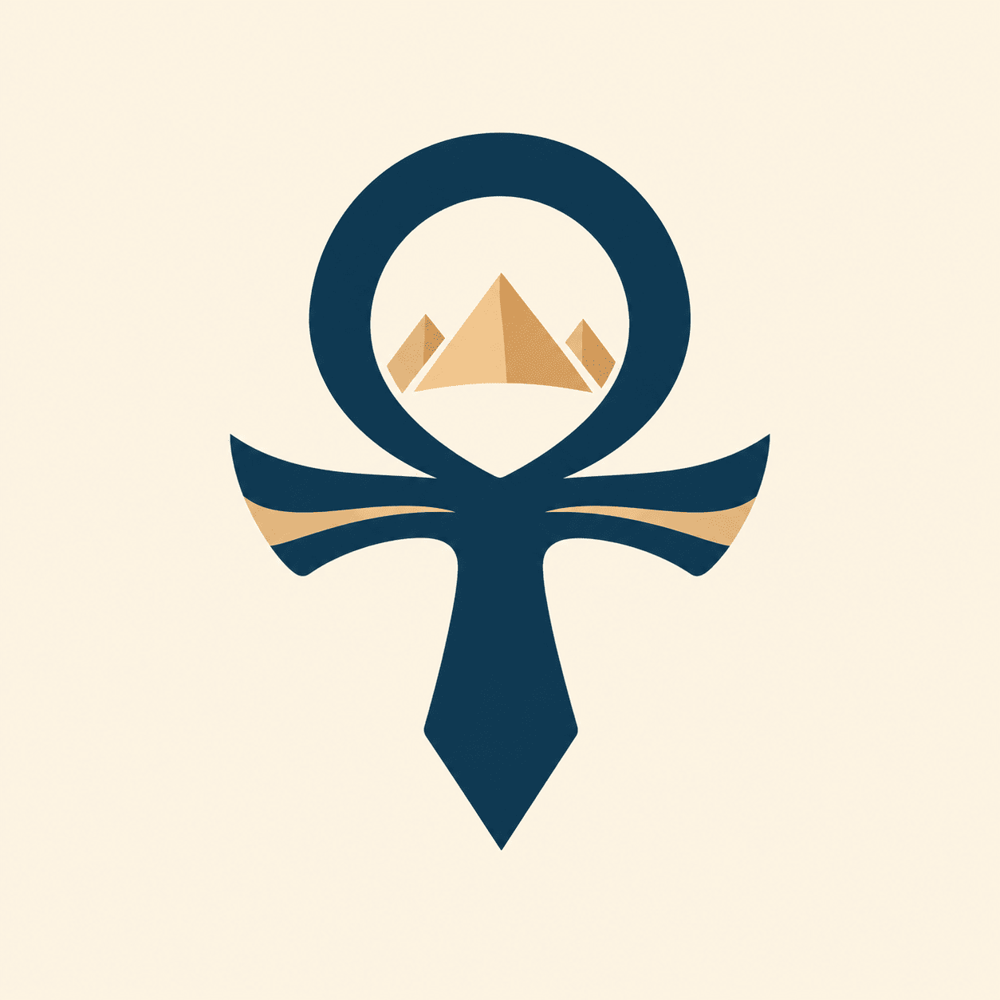
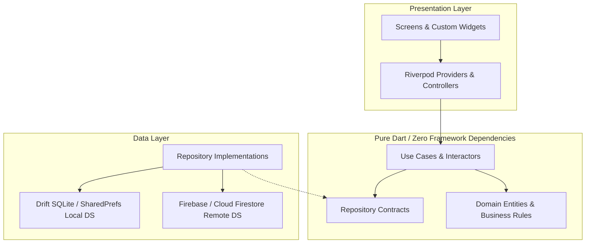

<div align="center">

  

  # Hana Masr (هنا مصر)
  ### The Intelligent, Offline-First Tourism Companion for Egypt

  [](https://flutter.dev)
  [](https://dart.dev)
  [](#architecture)
  [](#tech-stack)
  [](#offline-first-philosophy)
  [](#global-localization)
  [](#platform-support)

  <p align="center">
    <strong>A production-grade, enterprise-ready mobile platform engineered to empower travelers exploring Egypt with confidence, cultural immersion, transparent pricing, and zero connectivity constraints.</strong>
  </p>

</div>

---

## 🌟 Executive Overview

**Hana Masr** is not merely a travel guide; it is an intelligent mobility and cultural companion designed specifically for navigating Egypt's rich heritage sites and modern cities. Built with an **offline-first philosophy**, Hana Masr eliminates roaming friction and spotty desert connectivity by providing verified routes, transparent fare estimates, localized scam protection, and in-depth cultural insights in **15 languages**.

Every architectural layer adheres to strict **Clean Architecture** and **SOLID** principles, delivering predictable testability, modular maintainability, and fluid 60/120 FPS performance across iOS, Android, and Web.

---

## 💎 Key Highlights & Differentiators

```
┌───────────────────────────────────────────────────────────────────────────┐
│                           CORE VALUE PILLARS                             │
├─────────────────────┬─────────────────────┬───────────────────────────────┤
│   🛡️ Scam Shield    │  🌐 15 Languages    │  ⚡ 100% Offline-First        │
│   & Fair-Price DB   │   Full Native RTL   │   Zero-Network Reliance       │
├─────────────────────┼─────────────────────┼───────────────────────────────┤
│  🏛️ Heritage Theme  │  🧭 Multi-Modal     │  🏺 3D Ankh Launch            │
│   Authentic Pigments│   Transit Navigator │   Native OS + Flutter Splash  │
└─────────────────────┴─────────────────────┴───────────────────────────────┘
```

### 1. 🛡️ Scam Shield & Fair-Price Intelligence Engine
* **Fare Transparency**: Real-time reference fares for taxis, microbuses, feluccas, camels, and carriage rides per landmark.
* **Proactive Advisory**: Place-specific cultural awareness, tips on polite bargaining, and alerts regarding unauthorized touts.

### 2. ⚡ True Offline-First Architecture
* Complete core guides, interactive OpenStreetMap caches, and emergency directory accessible without internet or cellular roaming.
* Local SQLite persistence managed via **Drift ORM** and offline-bundled typography (**Cairo** and **Plus Jakarta Sans**).

### 3. 🌐 Global Reach: 15 Complete Languages
* First-class internationalization (`flutter gen-l10n` ARB pipeline) with complete semantic adaptations:
  * **RTL First**: Arabic (`ar`)
  * **European & Slavic**: English (`en`), Russian (`ru`), German (`de`), French (`fr`), Italian (`it`), Spanish (`es`), Polish (`pl`), Ukrainian (`uk`), Czech (`cs`), Dutch (`nl`), Serbian (`sr`)
  * **Asian**: Chinese (`zh`), Japanese (`ja`), Turkish (`tr`)

### 4. 🎨 Egyptian Heritage Design System
* A bespoke design language inspired by ancient Egyptian iconography and minerals:
  * **Lapis Lazuli (`#1F3A73`)** — Primary authority and royalty.
  * **Egyptian Gold (`#D4A24C`)** — Actions, illuminations, and focal points.
  * **Faience Turquoise (`#2BA39B`)** — Secondary accents and life motifs.
  * **Carnelian (`#B8322E`)** — High-visibility security warnings.
  * **Papyrus (`#F5EEDC`) & Basalt (`#17202A`)** — Ergonomic surfaces and dark backgrounds.

### 5. 🏺 Native Launch & 3D Ankh Experience
* Native OS launch screens across Android (`launch_background`), iOS (`LaunchScreen.storyboard`), and Web (`index.html`).
* In-engine 3D spinning **Ankh (Key of Life)** loader powered by vector `CustomPaint` with mathematical perspective projection and glowing gold shaders.

### 6. 🧭 Autonomous Offline Zone Resolution Engine (Schema v2)
* **3-Tier Administrative Hierarchy**:
  * **Level 1 (Governorates)**: 27 official governorates with resolved dissolve outlines (ISO 3166-2).
  * **Level 2 (Districts - Markaz/Qism/New Cities)**: 403 administrative districts (365 official CAPMAS/OCHA polygons, 22 new cities, ~11m precision).
  * **Level 3 (Localities)**: 1,275 urban neighbourhoods and cities loaded on demand.
  * **Overlay**: 42 hand-curated tourist destinations (Pyramids, GEM, Karnak, Siwa, Sharm, etc.).
* **Neighbouring-Country Land Mask**: Rejection of foreign points (Eilat, Aqaba, Haql, Gaza, Tobruk) with zero false-positives.
* **Smart Boundary Hysteresis & Coastline Snapping**: Eliminates jitter at district borders and snaps water/sea coordinates up to 25 km with confidence scoring.
* **Full Legal Attribution**: Public domain and CC BY-IGO compliant with dedicated in-app attribution screen.

---

## 🏗️ Architecture & Engineering Blueprint

Hana Masr implements **Feature-First Clean Architecture**, isolating business domains from infrastructure dependencies:



### Architectural Tenets
* **Framework Independence**: The domain layer contains strictly zero Flutter, Firebase, or external library imports.
* **Result Pattern (`Result<T>`)**: Functional failure modeling using immutable results instead of untyped runtime exceptions.
* **Unidirectional Data Flow**: State mutations occur strictly through Riverpod `Notifier` and `AsyncNotifier` primitives.

---

## 📂 Project Organization

```text
lib/
├── app.dart                   # Global MaterialApp configuration, theme wiring & router
├── bootstrap.dart             # Asynchronous pre-warm services (Firebase, local DB, fonts)
├── main.dart                  # Application entry point with native splash synchronization
│
├── core/                      # Shared infrastructure across features
│   ├── config/                # Environment variables & runtime constants
│   ├── constants/             # AssetPaths, FirestorePaths, StorageKeys
│   ├── di/                    # Dependency injection bindings (Riverpod)
│   ├── error/                 # Typed Failures and Exception hierarchy
│   ├── extensions/            # Context, Iterable, and String ergonomic extensions
│   ├── localization/          # AppLocales, LocaleController, LocalizedText models
│   ├── network/               # Connectivity monitor & network abstraction
│   ├── router/                # Declarative routing with go_router & RouteGuards
│   ├── storage/               # Drift SQLite schema & SharedPreferences wrappers
│   ├── theme/                 # AppTheme, HenaColors extension, AppTypography, AppSpacing
│   ├── utils/                 # Functional Result<T>, Debouncer, Formatters, Logger
│   └── widgets/               # Core design tokens (AnkhLoader, AppLoading, Buttons)
│
├── features/                  # Domain-sliced functional modules
│   ├── auth/                  # Anonymous & federated authentication
│   ├── explore/               # Discovery feed, categories, and curated gems
│   ├── places/                # Place guides, ticketing, hours, dress codes & maps
│   ├── scam_shield/           # Fair price reference cards & bargaining advisories
│   ├── transport/             # Getting There engine (Metro, Microbus, Ride-hail)
│   ├── trip_planner/          # Intelligent itinerary generator & timeline
│   ├── map/                   # Offline vector map layers & geolocation
│   ├── settings/              # Language picker (15 locales), theme switcher
│   └── splash/                # Native sync splash screen & golden progress capsule
│       ├── presentation/
│       │   ├── screens/       # SplashScreen
│       │   └── widgets/       # SplashLoadingBar, AnkhLoader
│
└── l10n/                      # ARB localization definitions
    ├── app_ar.arb             # Arabic (Default)
    ├── app_en.arb             # English
    ├── app_ru.arb             # Russian
    ├── app_de.arb             # German
    └── app_*.arb              # fr, it, es, pl, zh, nl, uk, cs, tr, sr, ja
```

---

## 🛠️ Technology Stack

| Domain | Technology | Justification |
|---|---|---|
| **Language & SDK** | Dart 3.12+ / Flutter 3.27+ | Sound null-safety, pattern matching, record types, Impeller rendering engine. |
| **State Management** | Flutter Riverpod 3.x | Compile-safe dependency injection, testability without widget trees. |
| **Navigation** | go_router 18.x | Declarative deep linking, stateful nested navigation, web URL synchronization. |
| **Local Persistence** | Drift (SQLite) | High-performance type-safe relational database with offline reactive streams. |
| **Cloud Services** | Firebase Suite | Firestore, Cloud Auth (Anonymous & OAuth), Cloud Storage, Push Messaging. |
| **Typography** | Google Fonts (Offline) | Self-hosted `Cairo` and `Plus Jakarta Sans` with runtime fetching disabled. |
| **Mapping Engine** | flutter_map + LatLong2 | Zero API billing fees, customizable OpenStreetMap vector tile caching. |
| **Localization** | Flutter gen-l10n | Native standard ARB compiler generating lightweight, type-safe localizers. |

---

## 🚀 Getting Started

### Prerequisites
* Flutter SDK `3.27.0` or higher
* Dart SDK `3.12.0` or higher
* Android Studio (SDK 34+) / Xcode (16+)
* Git

### Installation & Run

1. **Clone the repository:**
   ```bash
   git clone https://github.com/MahmoudAshraf19/Hena-Masr.git
   cd "Hena-Masr/Hena Masr App"
   ```

2. **Install dependencies:**
   ```bash
   flutter pub get
   ```

3. **Generate localization bindings:**
   ```bash
   flutter gen-l10n
   ```

4. **Launch on connected device or simulator:**
   ```bash
   flutter run
   ```

---

## 🌐 Localization Matrix (15 Locales)

| Code | Language | Native Name | Code | Language | Native Name |
|:---:|:---|:---|:---:|:---|:---|
| `ar` | Arabic | العربية (RTL) | `es` | Spanish | Español |
| `en` | English | English | `zh` | Chinese | 中文 (Simplified) |
| `ru` | Russian | Русский | `nl` | Dutch | Nederlands |
| `de` | German | Deutsch | `uk` | Ukrainian | Українська |
| `it` | Italian | Italiano | `cs` | Czech | Čeština |
| `fr` | French | Français | `tr` | Turkish | Türkçe |
| `pl` | Polish | Polski | `sr` | Serbian | Српски |
| `ja` | Japanese | 日本語 | | | |

---

## 🛡️ Code Quality & Quality Assurance

Hana Masr enforces rigorous static analysis standards:

```bash
# Run strict static code analyzer
flutter analyze

# Execute comprehensive unit and widget test suite
flutter test --coverage
```

### Architectural Rules
* Zero business logic inside UI Widgets.
* Zero concrete data layer classes imported into `domain`.
* All user-facing strings must originate from localized ARB files.

---

## 🗺️ Product Roadmap

- [x] **Phase 1: Foundation & Branding**
  - [x] Egyptian Heritage design token system
  - [x] Native OS Launch Screens (Android, iOS, Web)
  - [x] 3D Vector Ankh Loading Engine
  - [x] Full 15-Language internationalization suite
- [ ] **Phase 2: Core Experience**
  - [ ] Multi-City Guide database (Cairo, Giza, Luxor, Aswan, Alexandria, Red Sea)
  - [ ] Scam Shield & Fair Price reference cards
  - [ ] Offline OpenStreetMap vector tiles per governorate
- [ ] **Phase 3: Intelligence & Services**
  - [ ] Offline audio guide player
  - [ ] Grounded AI Cultural Guide
  - [ ] Verified local guide bookings and licensed transport arrangements

---

## 📄 License & Attribution

Designed and engineered with passion for Egypt.  
© 2026 **Hana Masr Team**. All rights reserved.